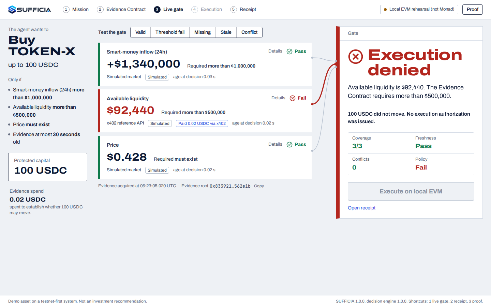
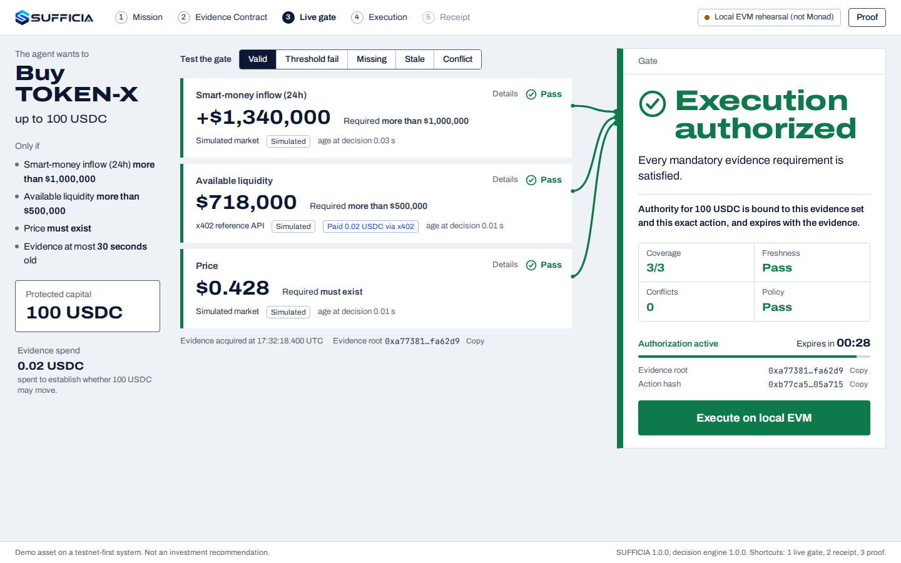
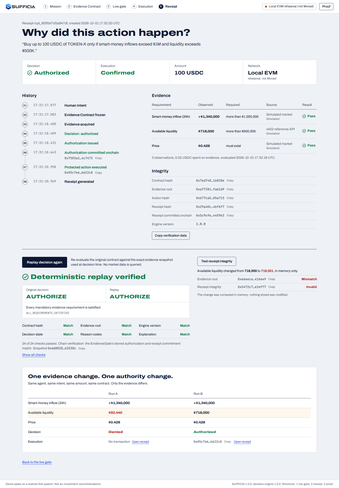

<p align="center"></p>

# SUFFICIA — Evidence-Bound Execution for Autonomous Agents

**Autonomous agents can already spend money. SUFFICIA makes them prove they know enough before they spend it.**

- **Bad evidence → DENIED.** Liquidity is $92,440; the principal required more than $500,000. No authorization is issued, `POST /decisions/{id}/execute` returns `403 EVIDENCE_AUTHORIZATION_REQUIRED`, and a receipt proves the money did not move.
- **Good evidence → Monad execution.** Fresh, consistent, x402-paid evidence satisfies every requirement → a short-lived authorization bound to *this* evidence and *this exact action* is committed to the `EvidenceGate` contract → the action executes once → the receipt hash is committed onchain → the decision replays to `MATCH`.

> Reasoning proposes. Evidence constrains. Policy decides. Authorization binds. Monad executes.

---

## Run it (2 minutes, no keys, no network)

```bash
make install          # pip install -e apps/api[dev] + contracts npm ci + web npm ci
make api              # API on http://127.0.0.1:8000/docs
make web              # web app on http://127.0.0.1:3000 (second terminal) → open /demo
make verify           # contracts + 1,270+ backend tests + 50/50 benchmark + HTTP integration + schema/fixture gates
                      #   + web lint, types, unit tests and production build
make e2e              # browser end-to-end tests against the real stack; writes screenshots A/B/C below
```

Or everything in containers: `docker compose up --build` → web app on `:3000`, API on `:8000`.
On Windows without `make`, the same steps in PowerShell are in [docs/deployment.md](docs/deployment.md#windows-powershell-no-make-no-c-compiler).
`make demo` runs the same Grand Prize scenario headless over HTTP.

Without configuration the API runs the **demo profile on an in-process EVM that executes the real `EvidenceGate`
bytecode** (`CHAIN_MODE=LOCAL_EVM`), and the web app says so in its header: *Local EVM rehearsal (not Monad)*. Point it
at Monad with `make deploy-testnet` and `CHAIN_MODE=MONAD_TESTNET` (see [docs/deployment.md](docs/deployment.md)).
Every evidence card carries its source mode — `LIVE`, `RECORDED`, `SIMULATED` or `INJECTED` — and simulated things
are never presented as live.

## The web app

Five screens, one decision each (Document 05). `/demo` opens the Grand Prize scenario directly on the Live Gate.

| | Screen | Question it answers |
|---|---|---|
| 01 | Mission `/` | What should the agent do? (live preview of what is enforced — and what is *not* understood, so not enforced) |
| 02 | Evidence Contract `/contract/{id}` | What must be true before money can move? |
| 03 | Live Gate `/gate/{id}` | May this action execute now? Evidence rows are wired into the gate; the rows that explain the decision are drawn in its color. *Test the gate*: Valid · Threshold fail · Missing · Stale · Conflict |
| 04 | Execution `/execution/{id}` | Is the authorization still valid, bound to this exact action, and did it execute? |
| 05 | Receipt `/receipt/{id}` | Why did this action happen — or why was it blocked? History, evidence, integrity, deterministic replay, tamper test, run comparison |

| A — Denied | B — Authorized | C — Receipt and replay |
|---|---|---|
|  |  |  |

The screenshots are produced by the end-to-end test (`make screenshots`), not mocked. Keyboard: `1` live gate,
`2` receipt, `3` proof drawer (benchmark, onchain transactions, audit log).

## What happens, step by step

| Step | Endpoint | What is committed |
|---|---|---|
| 1. Intent | `POST /api/v1/intents` | `intent_hash` |
| 2. Evidence Contract (frozen before any evidence) | `POST /api/v1/intents/{id}/compile` | `contract_hash` — thresholds, freshness, conflict tolerance, budget, TTL |
| 3. Evidence acquisition (x402-paid where required) | `POST /api/v1/contracts/{id}/acquire` | request/response hashes per item → `evidence_root` |
| 4. Deterministic decision | `POST /api/v1/contracts/{id}/decide` | `AUTHORIZE` · `DENY` · `ABSTAIN` · `REFRESH` · `ESCALATE` + reason codes + fingerprint |
| 5. Authorization (AUTHORIZE only) | `POST /api/v1/decisions/{id}/authorize` | `EvidenceGate.authorize(id, intent, contractHash, evidenceRoot, actionHash, executor, expiry, nonce)` |
| 6. Protected execution | `POST /api/v1/decisions/{id}/execute` | `EvidenceGate.executeAuthorized(id, action)` — exact action, single use, before expiry |
| 7. Receipt | `GET /api/v1/receipts/{id}` | `receipt_hash` → `EvidenceGate.recordReceipt` |
| 8. Replay | `POST /api/v1/receipts/{id}/replay` | recomputed from the decision-time snapshot, verified against chain state |

The LLM (optional) may only draft the Evidence Contract, and a draft that is weaker than the instruction is rejected.
It never touches threshold results, authorization validity, consumption or contract enforcement.

## Core invariants (all tested — see [docs/evidence/02-security-invariants.md](docs/evidence/02-security-invariants.md))

| | |
|---|---|
| INV-01 | No authorization without AUTHORIZE. |
| INV-02 | No AUTHORIZE with missing mandatory evidence. |
| INV-03 | No AUTHORIZE with stale mandatory evidence. |
| INV-04 | No AUTHORIZE with unresolved critical conflicts. |
| INV-05 | No AUTHORIZE when a mandatory threshold fails. |
| INV-06 | Authorization is bound to one action. |
| INV-07 | Authorization is bound to one Evidence Contract. |
| INV-08 | Authorization is bound to one Evidence Set. |
| INV-09 | Authority cannot outlive supporting evidence. |
| INV-10 | Authorization is single-use. |
| INV-11 | The LLM cannot override authority. |
| INV-12 | System uncertainty fails closed. |
| INV-13 | Replay with identical canonical inputs is deterministic. |
| INV-14 | Human explanations faithfully represent machine reasons. |
| INV-15 | Removing valid mandatory evidence cannot increase authority. |

## Monad integration

1. **Evidence economy** — evidence is bought per request with **x402 v2** (`exact` scheme, EIP-3009 USDC on
   `eip155:10143`, Monad facilitator), within a budget fixed by the Evidence Contract, before the decision.
2. **Authority commitment** — `EvidenceGate.sol` stores the authorization binding
   `contractHash + evidenceRoot + actionHash + executor + expiry` (≤ 600 s, and never beyond the evidence).
3. **Protected execution** — only the exact authorized action (target, value, calldata, assets, amounts, recipient,
   deadline, nonce — hashed with the chain id and gate address) can execute, once, by the designated executor.
4. **Receipt commitment** — the Evidence Execution Receipt hash is recorded onchain against the authorization.

## Evidence pack

Generated from real runs by `make evidence` (never typed by hand): [docs/evidence](docs/evidence)

| File | Content |
|---|---|
| [01-benchmark-report.md](docs/evidence/01-benchmark-report.md) | 50 hermetic cases (10 valid · 10 missing · 10 stale · 10 threshold · 5 conflict · 5 adversarial) — decision, reason, explanation and replay fidelity |
| [02-security-invariants.md](docs/evidence/02-security-invariants.md) | INV-01…INV-15 → test names → results |
| [03-smart-contract-tests.md](docs/evidence/03-smart-contract-tests.md) | EvidenceGate EVM tests, Foundry suite, compiler |
| [04-monad-proof.md](docs/evidence/04-monad-proof.md) | Addresses, authorization/execution/receipt transactions, events, hashes |
| [05-x402-proof.md](docs/evidence/05-x402-proof.md) | Quote, payment, reference, acquisition id, response hash, evidence item |
| [06-replay-report.md](docs/evidence/06-replay-report.md) | Decisions replayed, state / reason / hash matches |
| [07-demo-scenarios.md](docs/evidence/07-demo-scenarios.md) | Exactly which evidence mutation produces each of the five states |
| [08-known-limitations.md](docs/evidence/08-known-limitations.md) | What SUFFICIA does not claim |

## Repository

```
apps/api/            FastAPI service: intent compiler, evidence acquisition + x402, decision engine, chain gateway,
                     receipts, replay, Demo Lab, audit log   (sufficia/…, tests/…, migrations/, scripts/)
apps/web/            Next.js web app: Mission, Evidence Contract, Live Gate, Execution, Receipt + Replay
                     (src/app/…, src/components/…, tests/unit, e2e/ — Playwright against the real API)
contracts/           EvidenceGate.sol, DemoSwapRouter.sol, DemoERC20.sol, Foundry tests, deploy script
packages/schemas/    Generated JSON Schemas + OpenAPI
packages/sdk/        Minimal Python SDK (EvidenceGate.evaluate / execute / replay)
tests/benchmark/     The canonical 50-case benchmark (generated fixtures)
tests/integration/   Black-box HTTP test against a real uvicorn process
demo/scenarios/      Versioned scenarios: grand-prize-v1, valid-v1, threshold-fail-v1, missing-v1, stale-v1, conflict-v1
docs/                Architecture, API, security model, deployment, ADRs, evidence pack
```

Further reading: [architecture](docs/architecture.md) · [API](docs/api.md) · [security model](docs/security.md) ·
[deployment](docs/deployment.md) · [ADRs](docs/adr).

MIT licensed. Built for Monad Metropolis 2026.
