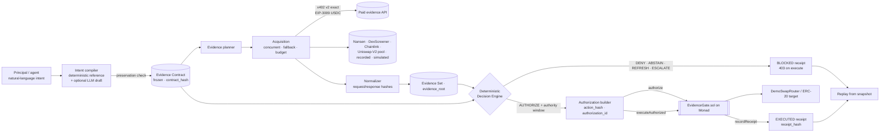

# Architecture

SUFFICIA puts an **evidence boundary** around an autonomous agent's economic authority. The agent (or its LLM) may
propose; only a frozen Evidence Contract, evaluated deterministically over provenance-bearing evidence, can produce an
authorization — and only the `EvidenceGate` contract can turn that authorization into one exact onchain action.

## Components (apps/api/sufficia)

| Package | Responsibility | Never does |
|---|---|---|
| `intent/` | Deterministic parser (EN/FR), contract builder with implicit restrictive requirements, optional Anthropic draft, **preservation check** (a draft or user override that relaxes any threshold, operator, amount, asset, freshness or policy is rejected) | Decide, authorize |
| `domain/` | Typed models, closed enums, claim registry (one canonical unit per claim), reason codes | Hold raw dicts in the authority path |
| `canonical/` | Canonical JSON (exact decimals, injective strings, tagged non-finite numbers), domain-separated keccak commitments, ABI-exact `action_hash` / `authorization_id` mirrors of the contract | Round, case-fold or float anything |
| `evidence/` | Planner (profile → ordered sources), adapters (untrusted boundaries returning raw observations or typed failures), normalizer (hashes, strict numeric/timestamp parsing), concurrent acquisition with fallback, two-source mode, budget gate | Return PASS/FAIL |
| `payments/x402/` | x402 v2 `exact` client: parse 402, validate network/asset/payTo/amount/budget **before** signing, EIP-712 `TransferWithAuthorization`, one signature per acquisition, idempotent resend | Make evidence valid because it was paid |
| `decision_engine/` | Pure `evaluate(contract, evidence, time, version)`: validation, dedupe, freshness, conflicts, thresholds, fixed precedence, reason codes, faithful explanations, evidence-bounded authority window; `build_authorization`; snapshots and replay | Read the clock, the network or the database |
| `execution/` | Execution adapters (DemoSwap, Transfer) that prepare the exact action, and `verify_spend` which re-decodes calldata against declared amounts, assets and recipient | Choose amounts beyond the contract |
| `blockchain/` | Web3 gateway (local signing, per-signer queues, EIP-1559 fees, revert decoding incl. nested `ExecutionFailed`, RPC failover, reconciliation by hash), in-process `LOCAL_EVM` running the real bytecode, deploy suite | Treat a submitted tx as confirmed |
| `services/` | Orchestrator (intent → contract → evidence → decision → authorize → execute → receipt → replay), receipts, hash-chained audit log, Demo Lab, scenario runner | Hold authority logic of its own |
| `api/` | FastAPI routes, exact JSON responses, API key / rate limit / body cap / security headers / request ids | Serialize a Decimal as a float |
| `db/` | SQLAlchemy 2 schema (SQLite / PostgreSQL) + Alembic migration; immutable canonical payloads next to indexed columns | Re-type hashed objects from columns |

## Decision precedence (fixed)

1. invalid contract → error (no decision)
2. missing / unaffordable / too few valid mandatory items → **ABSTAIN**
3. stale mandatory evidence → **REFRESH**
4. critical conflict between valid sources (relative difference strictly above tolerance) → **ESCALATE**
5. a valid mandatory condition fails → **DENY**
6. otherwise → **AUTHORIZE**, with `expires_at = min(evaluated_at + contract TTL, earliest mandatory evidence expiry)`;
   if fewer than one whole second of authority remains the decision is **REFRESH / AUTHORITY_WINDOW_EXHAUSTED**
   (the contract stores whole seconds and requires `expiresAt > issuedAt`).

There is no score: a failed mandatory condition can never be averaged away.

## Audit chain (Document 04 §81)

`contract_hash → evidence_root → decision (fingerprint) → action_hash → authorization_id → authorization tx →
execution tx → receipt_hash (committed onchain)` — returned as `audit_chain` by `GET /api/v1/receipts/{id}`.
Every step is recomputed by `POST /api/v1/receipts/{id}/replay`, which never queries current market data.

## Commitments

| Commitment | Encoding |
|---|---|
| `contract_hash` | `keccak("EVIDENCE_GATE_CONTRACT_V1" ‖ 0x00 ‖ canonical(contract semantics))` — ids, labels and requirement order excluded |
| evidence item hash | `keccak("EVIDENCE_GATE_EVIDENCE_V1" ‖ 0x00 ‖ canonical(item))` |
| `evidence_root` | `keccak("EVIDENCE_GATE_EVIDENCE_SET_V1" ‖ 0x00 ‖ count ‖ sorted unique item hashes)` — order-independent |
| decision fingerprint | `keccak(DECISION ‖ contract_hash ‖ evidence_root ‖ inputs_commitment ‖ evaluated_at ‖ engine_version)`; `inputs_commitment` covers acquisition failures and permitted sources |
| `action_hash` | `keccak(abi.encode(keccak("EVIDENCE_GATE_ACTION_V1"), chainid, gate, target, value, keccak(data), assetIn, maxAmountIn, assetOut, minAmountOut, recipient, deadline, nonce))` = `EvidenceGate.computeActionHash` |
| `authorization_id` | `keccak(abi.encode(keccak("EVIDENCE_GATE_AUTH_V1"), contractHash, evidenceRoot, actionHash, executor, nonce))` = `EvidenceGate.computeAuthorizationId` |
| `receipt_hash` | `keccak("EVIDENCE_GATE_RECEIPT_V1" ‖ 0x00 ‖ canonical(receipt body))` |
| audit event | `keccak("EVIDENCE_GATE_AUDIT_V1" ‖ 0x00 ‖ prev_hash ‖ canonical(event))` |

## Data model

`intents`, `evidence_contracts`, `requirements`, `evidence_sets` (immutable, versioned: acquisitions and Demo Lab
injections with parent links), `evidence_items`, `x402_payments`, `decisions` (with the canonical replay snapshot),
`verification_results`, `authorizations`, `executions`, `receipts`, `chain_transactions`, `chain_events`,
`audit_events` (hash-chained). Migration: `apps/api/migrations/versions/0001_initial_schema.py`.

## Chain modes

| `CHAIN_MODE` | Meaning |
|---|---|
| `LOCAL_EVM` (default) | In-process py-evm chain; the real `EvidenceGate`/router/token bytecode is deployed on first use; well-known dev keys; chain time tracks wall clock. Labelled "local-evm (py-evm, not Monad)" everywhere. |
| `MONAD_TESTNET` / `MONAD_MAINNET` | HTTP RPC with fallback, addresses from `DEPLOYMENT_FILE` or explicit env, keys from env. Missing configuration fails closed — it never silently falls back to local. |
| `DISABLED` | Decisions and receipts only; execution returns `503 CHAIN_DISABLED`. |
